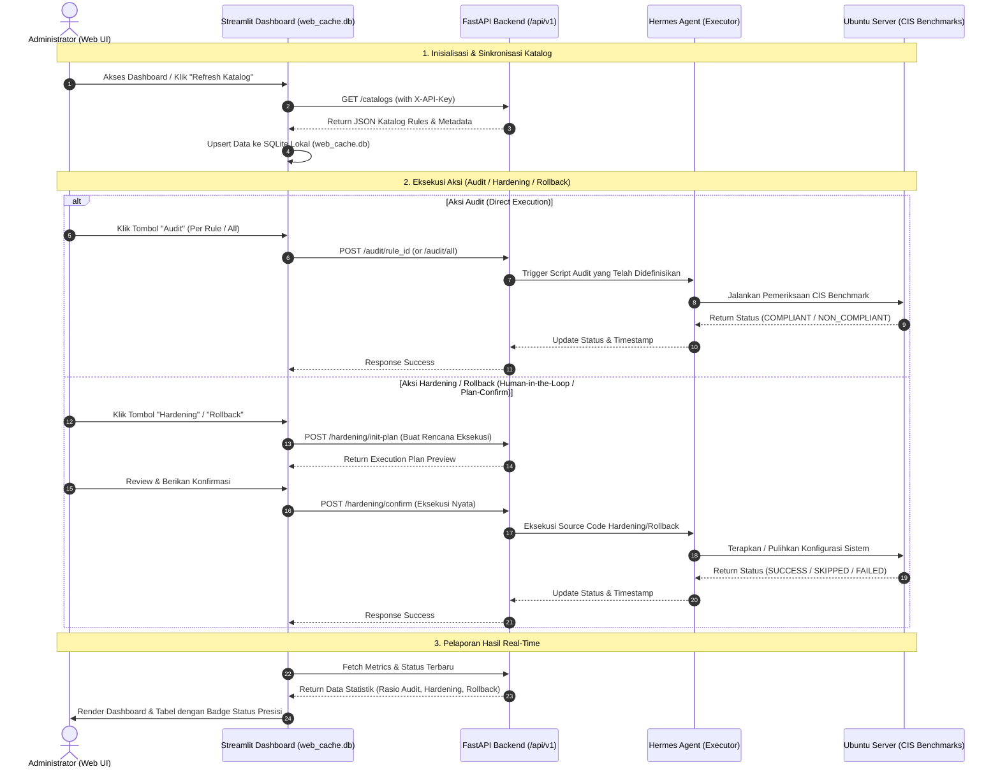

# Yoru Agent
Yoru-agent adalah agen otomatis untuk memeriksa dan meningkatkan keamanan server berdasarkan standar CIS. Dibangun menggunakan Hermes-agent dan FastAPI, sistem ini memudahkan pemeriksaan keamanan melalui API, serta mendukung proses audit, hardening, dan rollback. Setiap perubahan konfigurasi tetap berada di bawah kendali manusia agar keamanan server terjaga tanpa mengabaikan risiko operasional.

---

## Dislaimer

This project is an independent open-source automation tool designed for system hardening. It references industry security benchmarks (such as CIS Benchmarks) for compliance mapping purposes only and is not officially endorsed, sponsored, or affiliated with the Center for Internet Security (CIS).

---

## Daftar Katalog CIS Compliance
Yoru-agent menggunakan katalog berikut untuk melakukan audit dan hardening keamanan server berdasarkan standar CIS (Center for Internet Security).

| ID | Referensi CIS | Kategori | Deskripsi Kontrol | Mode |
| --- | --- | --- | --- | --- |
| K01 | 5.1.20 | SSH Security | Ensure sshd PermitRootLogin is disabled | Audit & Hardening |
| K02 | 5.2.14 | SSH Security | Ensure SSH PasswordAuthentication is disabled |	Audit & Hardening |
| K03 | 5.1.13 | SSH Security | Ensure sshd LoginGraceTime is configured | Audit & Hardening |
| K04 | 5.1.16 | SSH Security | Ensure sshd MaxAuthTries is configured | Audit & Hardening |
| K05 | 5.1.6 | SSH Security | Ensure sshd Ciphers are configured | Audit & Hardening |
| K06 | 5.1.7 | SSH Security | Ensure sshd MACs are configured | Audit & Hardening |
| K07 | 5.1.8 | SSH Security | Ensure sshd KexAlgorithms are configured	| Audit & Hardening |
| K09 | 4.1.1.2 | Audit Logging | Ensure auditd service is enabled and active | Audit Only |
| K10 | 6.1.1.2 | System Logging | Ensure journald log file access is configured | Audit & Hardening |
| K11 | 6.1.2.3 | System Logging | Ensure journald Compress is configured | Audit & Hardening |
| K13 | 4.2.3 | Firewall | Ensure ufw service is enabled | Audit Only |
| K14 | 4.2.7 | Firewall | Ensure ufw default deny firewall policy | Audit Only |
| K15 | 2.1.22 | Network Security | Ensure only approved services are listening on a network interface | Audit Only |
| K22 | 3.3.4 | Network Security | Ensure broadcast icmp requests are ignored |	Audit & Hardening |
| K23 | 3.3.5 | Network Security | Ensure icmp redirects are not accepted | Audit & Hardening |
| K24 | 3.3.8 | Network Security | Ensure source routed packets are not accepted | Audit & Hardening |
| K25 | 3.3.10 | Network Security | Ensure tcp syn cookies is enabled | Audit & Hardening |

**Keterangan Kategori**
- SSH Security: Mengamankan akses jarak jauh melalui SSH.
- Audit Logging: Memastikan layanan pencatatan aktivitas keamanan tersedia.
- Firewall: Memeriksa status firewall dan kebijakan lalu lintas jaringan.
- Network Security: Mengamankan layanan jaringan dan perilaku konfigurasi jaringan kernel.
- System Logging: Mengatur penyimpanan, akses, dan pengelolaan log sistem.

**Keterangan Mode**
- Audit & Hardening: Sistem memeriksa konfigurasi dan dapat menerapkan perbaikan otomatis sesuai kebijakan.
- Audit Only: Sistem hanya memeriksa dan melaporkan hasil tanpa mengubah konfigurasi server.

## 📄 Product Requirement Document (PRD): Yoru-Agent
> **Automated Ubuntu Server Hardening, Auditing & Rollback Platform with Human-in-the-Loop & Local Persistence**

---

### 1. 🎯 Overview & Objectives
**Yoru-Agent** adalah sistem otomatisasi keamanan berbasis *CIS Benchmarks* untuk sistem operasi Ubuntu Server. Sistem ini dirancang secara modular menggunakan arsitektur pemisahan layanan antara **FastAPI Backend**, **Streamlit Web Dashboard** (dengan *local SQLite caching*), dan **Hermes Agent** sebagai *executor* di level sistem.

---

### 2. 🔄 System Architecture & Workflow Diagram

Berikut adalah alur proses (*Workflow*) dari interaksi pengguna melalui web dashboard hingga eksekusi perintah oleh Hermes Agent di server:



---

### 3. 🛠️ Core Components & Responsibilities

| Komponen | Teknologi | Tanggung Jawab Utama |
| --- | --- | --- |
| Frontend Dashboard | Streamlit, Python | Menampilkan metrik grafana-style (Rasio Audit, Hardening, Rollback), tabel data paginasi, tombol aksi bersyarat (`audit_only`), serta caching lokal via `sqlite3` (`web_cache.db`). |
| Backend API | FastAPI, Python | Menyediakan RESTful API yang dilindungi otentikasi `X-API-Key`, mengelola endpoint katalog, manajemen plan, dan koordinasi eksekusi. |
| Execution Engine | Hermes Agent, Taskfile, Python | Mengeksekusi source code modular yang telah didefinisikan sebelumnya untuk setiap rule CIS Benchmark secara langsung di Ubuntu Server. |
| Security & Compliance | CIS Benchmarks, SQLite | Menjaga integritas sistem dengan mekanisme Two-Step Execution (Init Plan -> Konfirmasi) khusus untuk aksi perubahan sistem (Hardening dan Rollback). |

---

## 📋 Persyaratan
Sebelum memulai, pastikan komputer atau server Anda memenuhi persyaratan berikut:
- **Sistem operasi:** Ubuntu atau Debian.
- **Python:** Versi 3.10 atau lebih baru.
- **Hermes Agent:** Sudah terpasang. Ikuti panduan di repositori [Hermes Agent](https://github.com/nousresearch/hermes-agent).
- **Task CLI (Taskfile):** Sudah terpasang jika diperlukan oleh proyek.
- **Dependensi Python:** `python3-venv`, untuk membuat lingkungan Python terpisah.
- **Hak akses administrator:** Akun dengan akses sudo untuk memasang dan mengonfigurasi sistem.

**Catatan:** Pastikan Anda memahami perintah yang dijalankan dengan sudo, karena perintah tersebut dapat mengubah konfigurasi sistem.

---

## 🚀 Panduan Instalasi (Quick Start)
Ikuti langkah-langkah berikut untuk memasang dan menjalankan **Yoru-Agent** di server Ubuntu/Debian Anda.

### 1. Unduh Proyek (Clone Repository)
Salin (clone) repository ini ke komputer Anda, lalu masuk ke direktori proyek:
```bash
git clone https://github.com/rahardian-dwi-saputra/yoru-agent.git
cd yoru-agent
```
### 2. Jalankan Instalasi Otomatis
Jalankan perintah berikut untuk memulai instalasi otomatis:
```bash
sudo bash install.sh
```
Skrip ini akan secara otomatis:
1. Membuat dan mengkonfigurasi system user `yoru-agent`.
2. Mendaftarkan hak akses sudoers terbatas untuk utilitas kernel, firewall, dan system service.
3. Membuat Python virtual environment di dalam folder `venv/`.
4. Men-generate dan mengamankan API Key rahasia (`api/key.txt`) dengan izin akses ketat (`chmod 600`).

### 3. Masuk sebagai User `yoru-agent`
Skrip setup otomatis membuat pengguna sistem baru bernama `yoru-agent`. Beralihlah ke pengguna tersebut untuk menjalankan aplikasi:
```bash
sudo su - yoru-agent
```
### 4. Masuk ke Folder API
Pindah ke direktori api yang berada di dalam folder proyek Anda:
> Catatan: Ganti (nama-user-lama) dengan nama username utama komputer Anda sebelumnya tempat folder proyek diunduh.
```bash
cd /home/(nama-user-lama)/yoru-agent
```

### 5. Aktifkan Virtual Environment & Jalankan Server API
Aktifkan environment Python dan jalankan server FastAPI menggunakan `uvicorn`:
```bash
source venv/bin/activate
uvicorn main:app --host 0.0.0.0 --port 8000
python -m uvicorn api.main:app --host 0.0.0.0 --port 8000
```

## ⚙️ Menjalankan Yoru-Agent
Yoru-Agent memiliki dua komponen yang perlu dibedakan: server API dan antarmuka aplikasi.

### 1. Menjalankan Server API
Server API menggunakan FastAPI untuk menangani permintaan dari aplikasi. Pastikan Anda berada di direktori proyek dan lingkungan Python sudah aktif. Jalankan server sesuai struktur aplikasi Anda.

```bash
source api/venv/bin/activate
python3 api/main.py
streamlit run app.py
```

### 2. Menjalankan Antarmuka Aplikasi
Jika proyek menggunakan Streamlit sebagai antarmuka pengguna, buka terminal lain, masuk ke direktori proyek, lalu aktifkan virtual environment yang sama. Jalankan:
```bash
streamlit run app.py
```

---

## 📊 Memantau Log Aktivitas (OS-Level Audit Trail)
Yoru-Agent menggunakan journalctl untuk membaca catatan aktivitas sistem yang dikirim ke Linux System Journal (journalctl). 

### 1. Memantau Log Secara Langsung
Anda dapat memantau seluruh aktivitas audit, hardening, atau rollback secara real-time menggunakan perintah:
```bash
journalctl -t yoru-agent -f
```
Perintah ini akan terus menampilkan log saat ada aktivitas baru. Untuk berhenti memantau, tekan `Ctrl + C`.

### 2. Melihat 20 Log Terakhir
Untuk melihat 20 log terakhir yang dicatat oleh Yoru-Agent gunakan perintah berikut:
```bash
journalctl -t yoru-agent -n 20 --no-pager
```

### 3. Melihat Log Peringatan dan Kesalahan
Melihat log khusus yang berstatus FAILED atau ERROR saja:
```bash
journalctl -t yoru-agent -p warning
```

---

## 🗑️ Menghapus Yoru-Agent
Jika ingin menghapus Yoru-Agent, ikuti langkah berikut.

### 1. Jalankan Skrip Uninstall
Skrip uninstall berada di folder setup. Dari direktori utama proyek, jalankan:
```bash
sudo bash setup/uninstall.sh
```
Skrip ini digunakan untuk menghapus konfigurasi yang dikelola oleh proses instalasi.

### 2. Hapus Folder Proyek
Setelah proses uninstall selesai, Anda dapat menghapus folder proyek jika sudah tidak diperlukan. Kembali ke direktori induk proyek terlebih dahulu, kemudian jalankan perintah dengan lokasi folder yang benar. Contohnya:
```bash
cd /home/NAMA_USER
sudo rm -rf yoru-agent
```
Ganti NAMA_USER dengan nama pengguna Linux yang sesuai.