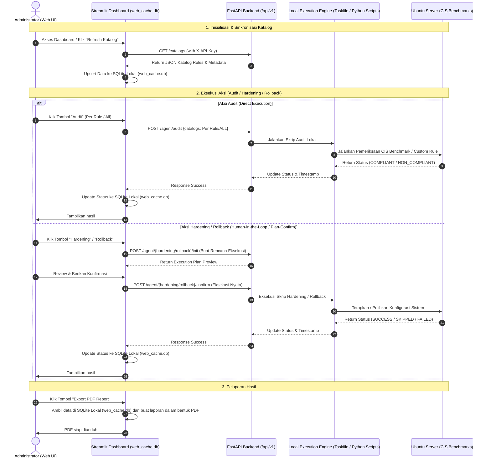

# Yoru Agent
Yoru-Agent adalah alat otomatis yang membantu memeriksa, memperbaiki dan meningkatkan keamanan server agar lebih terlindungi dari serangan peretas (hacker). 
Yoru-Agent bekerja seperti satpam digital. Alat ini memeriksa apakah keamanan server apakah sudah cukup kuat, menemukan bagian yang masih lemah, dan membantu memperbaikinya agar lebih aman. 
Yoru-Agent menggunakan standar keamanan internasional yang disebut CIS Benchmarks sebagai panduan untuk memeriksa keamanan server. Selain itu, Yoru-Agent juga menghubungkan hasil pemeriksaan tersebut dengan aturan perlindungan data pribadi di Indonesia, yaitu UU No. 27 Tahun 2022 tentang Pelindungan Data Pribadi (UU PDP).

---

## Disclaimer

Proyek ini merujuk pada standar industri (CIS Benchmarks) dan UU PDP semata-mata untuk kebutuhan pemetaan kepatuhan teknis, serta tidak didukung secara resmi, disponsori, atau berafiliasi dengan Center for Internet Security (CIS) maupun lembaga penegak hukum terkait.

---

## 📂 Struktur Proyek
```text
yoru-agent/
├── api/                       # Source code REST API berbasis FastAPI
├── catalog/                   # Implementasi katalog audit, hardening, dan hardening
│   └── ...                    # Script dan log aktivitas setiap katalog
├── config/                    # Modul konfigurasi aplikasi
│   ├── api.py                 # Konfigurasi REST API (FastAPI) 
│   ├── settings.py            # Konfigurasi Sistem dan Catalog
│   └── web.py                 # Konfigurasi Web Dashboard (Streamlit)
├── pipeline                   # Modul pendukung dan utilitas aplikasi
│   └── catalogutils.py        # Class dan helper untuk operasional katalog
├── offensive/                 # Pengujian hasil hardening
│   └── README.md              # Intruksi cara menguji hasil hardening
├── setup/                     # Skrip dan konfigurasi instalasi
│   ├── setup-dependencies.sh  # Membuat virtual environment dan menginstal dependency
│   ├── setup-environment.sh   # Membuat system user dan mengatur hak akses
│   ├── setup-permission.py    # Mengatur hak akses file dan direktori
│   ├── uninstall.sh           # Menghapus konfigurasi instalasi Yoru-Agent
│   └── yoru-agent.sudoers     # Konfigurasi hak akses sudoers untuk system user
├── web/                       # Source code Web Dashboard berbasis Streamlit
├── .env                       # Konfigurasi environment aplikasi (tidak dilacak Git)
├── .env.example               # Template konfigurasi environment
├── .gitignore                 # Daftar file yang diabaikan Git
├── install.sh                 # Skrip utama instalasi otomatis
├── start-yoru-agent.sh        # Skrip untuk menjalankan layanan Yoru-Agent
├── Taskfile.yml               # Definisi task untuk mengelola aplikasi
└── README.md                  # Dokumentasi utama proyek
```

---

## Daftar Katalog CIS Compliance
Yoru-agent menggunakan katalog berikut untuk melakukan audit dan hardening keamanan server berdasarkan standar CIS Ubuntu Linux 24.04 LTS Benchmark v2.0.0 dan Undang-Undang Nomor 27 Tahun 2022 tentang Pelindungan Data Pribadi (UU PDP).

| ID | Referensi CIS | UU PDP | Kategori | Nama Kontrol | Mode |
| --- | --- | --- | --- | --- | --- |
| K01 | 5.1.20 | Pasal 35, Pasal 36, Pasal 39 | SSH Security | Root Tidak Bisa Login Lewat SSH | Audit & Hardening |
| K02 | - | Pasal 35, Pasal 36, Pasal 39 | SSH Security | Login SSH menggunakan Password Dimatikan (Khusus SSH Key) |	Audit & Hardening |
| K03 | 5.1.13 | Pasal 35, Pasal 39 | SSH Security | Membatasi Waktu Login SSH (LoginGraceTime) | Audit & Hardening |
| K04 | 5.1.16 | Pasal 35, Pasal 39 | SSH Security | Membatasi Percobaan Auth SSH (MaxAuthTries) | Audit & Hardening |
| K05 | 5.1.6 | Pasal 35, Pasal 39 | SSH Security | Pengaturan Ciphers SSH yang Aman (Enkripsi Transport) | Audit & Hardening |
| K06 | 5.1.15 | Pasal 35, Pasal 39 | SSH Security | Pengaturan MACs SSH yang Aman (Integritas Pesan) | Audit & Hardening |
| K07 | 5.1.12 | Pasal 35, Pasal 39 | SSH Security | Pengaturan KexAlgorithms SSH yang Aman	| Audit & Hardening |
| K08 | 6.2.1.2 | Pasal 35, Pasal 39 | Logging and Auditing | Layanan Auditd Aktif dan Berjalan | Audit Only |
| K09 | 6.1.1.2 | Pasal 35, Pasal 36 | Logging and Auditing | Pengaturan Akses File Log Journald | Audit & Hardening |
| K10 | 6.1.2.4 | Pasal 31, Pasal 35 | Logging and Auditing | Penyimpanan Log Journald Permanen | Audit & Hardening |
| K11 | 6.1.1.3 | Pasal 31, Pasal 35 | Logging and Auditing | Konfigurasi Rotasi File Log Journald | Audit & Hardening |
| K12 | 1.2.2.1 | Pasal 35, Pasal 39 | System Security / Patch Management | Memastikan Pembaruan, Patch, dan Perangkat Lunak Keamanan Terpasang | Audit Only |
| K13 | 4.2.3 | Pasal 35, Pasal 39 | Firewall | Memastikan Layanan UFW Aktif | Audit Only |
| K14 | 4.2.7 | Pasal 35, Pasal 39 | Firewall | Pengaturan Kebijakan Default UFW Firewall (Deny By Default) | Audit Only |
| K15 | 2.1.22 | Pasal 35, Pasal 39 | Network Security | Pengaturan Layanan Jaringan yang Mendengarkan Interface Network | Audit Only |
| K16 | 3.3.4 | Pasal 35, Pasal 39 | Network Security | Pengabaian Permintaan ICMP Broadcast | Audit & Hardening |
| K17 | 3.3.5 | Pasal 35, Pasal 39 | Network Security | Penolakan ICMP Redirect | Audit & Hardening |
| K18 | 3.3.8 | Pasal 35, Pasal 39 | Network Security | Penolakan Source Routed Packets | Audit & Hardening |
| K19 | 3.3.10 | Pasal 35, Pasal 39 | Network Security | Pengaktifan TCP SYN Cookies | Audit & Hardening |

**Keterangan Kategori**
- SSH Security: Mengamankan akses jarak jauh melalui SSH.
- Logging and Auditing: Memastikan mekanisme pencatatan aktivitas dan audit keamanan tersedia, berjalan, serta memiliki konfigurasi penyimpanan dan pengelolaan log yang sesuai.
- System Security / Patch Management: Memeriksa pembaruan sistem operasi, patch keamanan, dan perangkat lunak untuk membantu menjaga sistem dari kerentanan yang telah diketahui.
- Firewall: Memeriksa status layanan firewall dan kebijakan pengendalian lalu lintas jaringan untuk membatasi akses yang tidak diizinkan.
- Network Security: Mengamankan layanan jaringan dan konfigurasi parameter jaringan pada kernel Linux untuk mengurangi potensi serangan berbasis jaringan.

**Keterangan Mode**
- Audit & Hardening: Sistem melakukan pemeriksaan konfigurasi keamanan dan menyediakan mekanisme penerapan perbaikan konfigurasi secara otomatis sesuai kebijakan keamanan yang ditetapkan
- Audit Only: Sistem hanya melakukan pemeriksaan dan pelaporan kondisi konfigurasi keamanan tanpa melakukan perubahan terhadap konfigurasi server.

## 📄 Product Requirement Document (PRD): Yoru-Agent
> **Automated Ubuntu Server Hardening, Auditing & Rollback Platform with Human-in-the-Loop & Local Persistence**

---

### 1. 🎯 Overview & Objectives
**Yoru-Agent** adalah platform otomatisasi keamanan dan kepatuhan sistem untuk Ubuntu Server yang memadukan CIS Benchmarks dengan Custom Rules berbasis UU PDP (Pelindungan Data Pribadi). Didukung oleh **Gemini AI API**, sistem ini mampu membaca dan menganalisis log dari aktivitas audit, hardening, dan rollback, lalu menyajikan saran mitigasi serta analisis akar masalah. Sistem ini dirancang secara modular dan efisien menggunakan arsitektur pemisahan layanan antara **FastAPI Backend**, **Streamlit Web Dashboard** (dengan local *SQLite caching*), serta sistem eksekusi berbasis skrip lokal.

---

### 2. 🔄 System Architecture & Workflow Diagram

Berikut adalah alur proses (Workflow) dari interaksi pengguna melalui web dashboard hingga eksekusi perintah keamanan langsung di server:



---

### 3. 🛠️ Core Components & Responsibilities

| Komponen | Teknologi | Tanggung Jawab Utama |
| --- | --- | --- |
| AI Security Analyzer | Gemini AI API | Membaca file log dari aktivitas audit, hardening, dan rollback, lalu memberikan analisis akar masalah (root cause) serta rekomendasi saran keamanan berdasarkan temuan log tersebut. |
| Frontend Dashboard | Streamlit, Python | Menampilkan Informasi Server (Sistem Operasi, hostname, dan arsitektur), metrik operasional (Rasio Audit, Hardening, Rollback), tabel daftar katalog interaktif, dan detail katalog |
| Backend API | FastAPI, Python | Menyediakan RESTful API yang aman dengan otentikasi `X-API-Key`, mengelola endpoint katalog, manajemen plan, serta orkestrasi tugas. |
| Execution Engine | Taskfile, Python Scripts | Mengeksekusi modul audit, hardening, dan rollback CIS Benchmark / Custom Rule secara langsung di lingkungan Ubuntu Server secara aman dan terstruktur. |
| Security & Compliance | CIS Benchmarks, UU PDP | Menjaga integritas sistem dengan mekanisme Two-Step Execution (Init Plan -> Konfirmasi) khusus untuk aksi perubahan sistem (Hardening dan Rollback). |

---

## 📋 Persyaratan
Sebelum memulai, pastikan komputer atau server Anda memenuhi persyaratan berikut:
1. **Sistem Operasi**
- **Ubuntu Server 24.04 LTS** sebagai sistem operasi yang digunakan untuk menjalankan Yoru-Agent.
2. **Lingkungan Python**
- **Python 3.10** atau lebih baru untuk menjalankan aplikasi dan seluruh modul pendukungnya.
- **Python Virtual Environment (python3-venv)** untuk membuat lingkungan Python terisolasi dari instalasi Python sistem.
3. **Utilitas Pendukung**
- **Task CLI (Taskfile)** untuk menjalankan dan mengelola task aplikasi, seperti memulai, menghentikan, dan memulai ulang layanan Yoru-Agent. Untuk detailnya cek [disini](https://taskfile.dev/docs/installation)
4. **Hak Akses Sistem**
- **Hak akses administrator (sudo)** diperlukan untuk menjalankan proses instalasi, membuat system user, mengatur hak akses, serta menerapkan konfigurasi sistem yang dibutuhkan Yoru-Agent.

**Catatan:**
- Pastikan koneksi internet tersedia selama proses instalasi untuk mengunduh dan memasang dependensi yang diperlukan.
- Gunakan perintah dengan hak akses administrator secara hati-hati dan pastikan Anda memahami tindakan yang dijalankan oleh setiap skrip instalasi.

---

## 🚀 Panduan Instalasi (Quick Start)
Ikuti langkah-langkah berikut untuk memasang dan menjalankan **Yoru-Agent** di server Ubuntu/Debian Anda.

### 1. Unduh Proyek (Clone Repository)
Salin (clone) repository ini ke komputer Anda, lalu masuk ke direktori proyek:
```bash
git clone https://github.com/rahardian-dwi-saputra/yoru-agent.git
cd yoru-agent
```

### 2. Atur kredential
Buat file `.env` baru berdasarkan file contoh:
```bash
cp .env.example .env
```
Buka dan edit file `.env` menggunakan teks editor (misalnya `nano`):
```bash
nano .env
```
Masukkan kunci API Anda pada baris `GEMINI_API_KEY`:
```plaintext
GEMINI_API_KEY=kunci_api_anda_disini
```
> 💡 Tips: Jika Anda belum memilikinya, Anda dapat membuat kunci API secara gratis melalui [Google AI Studio](https://aistudio.google.com/welcome).

Masukkan password untuk mengakses web dashboard
```plaintext
DASHBOARD_PASSWORD=password_dashboard_anda
```
Simpan dan keluar dari editor (`Ctrl + O`, lalu `Enter`, kemudian `Ctrl + X` jika menggunakan `nano`).

### 3. Jalankan Instalasi Otomatis
Jalankan perintah berikut untuk memulai instalasi otomatis:
```bash
sudo bash install.sh
```
Skrip `install.sh` akan menjalankan proses instalasi secara bertahap melalui dua skrip utama:
1. **setup-environment.sh**: membuat system user khusus bernama `yoru-agent`, mengatur hak akses sudoers secara terbatas untuk kebutuhan operasional Yoru-Agent, dan mengatur kepemilikan dan hak akses direktori proyek agar dapat diakses oleh system user `yoru-agent`.
2. **setup-dependencies.sh**: membuat Python virtual environment pada direktori `venv/`, menginstal seluruh dependency Python yang dibutuhkan Yoru-Agent, membuat dan mengatur akses API Key.

### 4. Menjalankan API dan web
Pastikan Anda berada di direktori utama proyek `yoru-agent`, kemudian jalankan perintah berikut:
```bash
task start
```
Perintah tersebut akan menjalankan task start yang mengeksekusi skrip `start-yoru-agent.sh`.
Skrip ini bertanggung jawab untuk memulai layanan API dan Web Dashboard Yoru-Agent sesuai konfigurasi yang telah ditentukan.

### 5. Mengakses Aplikasi
Setelah layanan API dan Web Dashboard berhasil dijalankan, buka browser dan akses alamat berikut:
```text
http://IP_Server:8501
```
- Ganti IP_Server dengan alamat IP server tempat Yoru-Agent diinstal.
- Pastikan port 8501 dapat diakses melalui jaringan dan tidak diblokir oleh konfigurasi firewall.

### 6. Buka Akses
Jika port yang digunakan oleh FAST API dan streamlit diblokir oleh firewall (ufw) jalankan perintah sebagai berikut:
```bash
sudo ufw allow 8000/tcp
sudo ufw allow 8501/tcp
sudo ufw reload
```

### 7. Mengelola Layanan Aplikasi
Yoru-Agent menyediakan beberapa perintah untuk mengelola layanan API dan Web Dashboard melalui Taskfile.
Untuk menghentikan layanan API dan Web Dashboard, jalankan:
```bash
task stop
```
Untuk memulai ulang layanan API dan Web Dashboard, jalankan:
```bash
task restart
```
Untuk menjalankan layanan API dan Web Dashboard setelah sebelumnya dihentikan, jalankan:
```bash
task start
```
Seluruh perintah tersebut harus dijalankan dari direktori utama proyek `yoru-agent`.

---

## 📊 Memantau Log Aktivitas (OS-Level Audit Trail)
Yoru-Agent menggunakan journalctl untuk membaca catatan aktivitas sistem yang dikirim ke Linux System Journal (journalctl). 

### 1. Memantau Log Secara Langsung
Anda dapat memantau seluruh aktivitas audit, hardening, atau rollback secara real-time menggunakan perintah:
```bash
journalctl -t yoru-agent -f
```
Perintah ini akan terus menampilkan log saat ada aktivitas baru. Untuk berhenti memantau, tekan `Ctrl + C`.

### 2. Melihat 20 Log Terakhir
Untuk melihat 20 log terakhir yang dicatat oleh Yoru-Agent gunakan perintah berikut:
```bash
journalctl -t yoru-agent -n 20 --no-pager
```

### 3. Melihat Log Peringatan dan Kesalahan
Melihat log khusus yang berstatus FAILED atau ERROR saja:
```bash
journalctl -t yoru-agent -p warning
```

---

## 🗑️ Menghapus Yoru-Agent
Apabila Yoru-Agent tidak lagi digunakan, Anda dapat menghapus instalasi dan seluruh direktori proyek dengan mengikuti tahapan berikut.

### 1. Jalankan Skrip Uninstall
Skrip uninstall tersedia di dalam direktori setup/. Pastikan Anda berada di direktori utama proyek `yoru-agent`, kemudian jalankan salah satu perintah berikut.
```bash
sudo bash setup/uninstall.sh
```
Atau menggunakan Taskfile:
```bash
task uninstall
```
Skrip uninstall akan menjalankan proses pembersihan konfigurasi sistem yang sebelumnya dikelola oleh proses instalasi Yoru-Agent. Proses ini meliputi:
- Menghentikan layanan API dan Web Dashboard Yoru-Agent.
- Menghapus konfigurasi system user dan hak akses sudoers yang dibuat khusus untuk Yoru-Agent.
- Menghapus konfigurasi sistem dan file pendukung instalasi yang dikelola oleh skrip uninstall.
Pastikan proses uninstall berhasil diselesaikan sebelum melanjutkan ke tahap berikutnya.

### 2. Hapus Folder Proyek
Setelah proses uninstall selesai, Anda dapat menghapus direktori proyek beserta seluruh file aplikasi apabila sudah tidak diperlukan. Kembali ke direktori induk tempat Yoru-Agent berada. Contohnya, jika proyek berada di `/home/NAMA_USER/yoru-agent`, jalankan:
```bash
cd /home/NAMA_USER
sudo rm -rf yoru-agent
```
Ganti NAMA_USER dengan nama pengguna Linux yang sesuai dengan lokasi instalasi proyek.
**Perhatian:** Perintah rm -rf akan menghapus direktori proyek beserta seluruh isinya secara permanen. Pastikan tidak ada file konfigurasi, database, log, backup, atau data penting yang masih diperlukan sebelum menjalankan perintah tersebut.